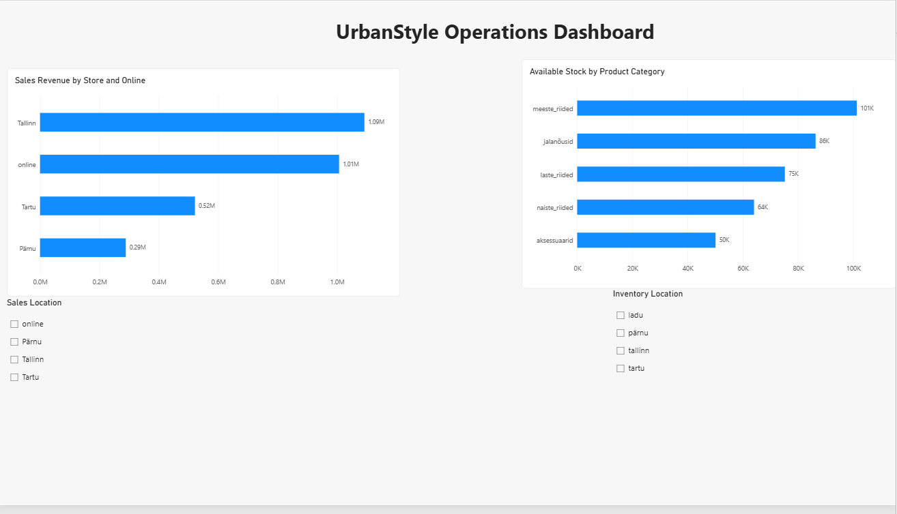
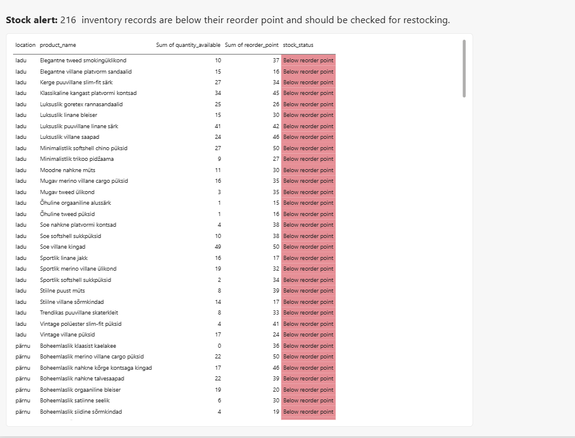

# Week 5 — Visualisation Design

## My role and objective

I worked on **Role C — Operations**, building a Power BI report for Liis using the UrbanStyle course data.

My task was to compare sales by location and stock by product category. I also added a stock-alert page to identify inventory records below their recorded reorder point.

## What I found

Tallinn and online were the two largest sources of sales revenue in the report. Men's clothing had the highest recorded stock, while accessories had the lowest. A separate check flagged **216 inventory records** below their reorder point.

The revenue and category-stock figures below are rounded values from the dashboard's all-locations view.

### Sales revenue by location

| Location or channel | Approximate sales revenue |
| --- | ---: |
| Tallinn | €1.09 million |
| Online | €1.01 million |
| Tartu | €0.52 million |
| Pärnu | €0.29 million |

Tallinn generated the most revenue, with online sales close behind. What stood out to me was how close online was to the highest-revenue physical store. Online is an important part of the sales picture, although revenue alone does not tell us which channel is most profitable.

### Recorded stock by product category

| Product category | Approximate recorded stock |
| --- | ---: |
| Men's clothing | 101,000 units |
| Footwear | 86,000 units |
| Children's clothing | 75,000 units |
| Women's clothing | 64,000 units |
| Accessories | 50,000 units |

Men's clothing had roughly twice the recorded stock of accessories. This describes the stock mix, not customer preferences or sales performance. Liis would need to compare these quantities with demand before deciding whether any category is overstocked or understocked.

### Inventory below the reorder point

I created `stock_status` using this comparison:

`quantity_available < reorder_point`

Records meeting the condition were labelled **Below reorder point**. The other records were labelled `ok`. Because the rule uses `<`, a quantity exactly equal to its reorder point is not flagged.

The check identified **216 inventory records in the retained data**. These are product-location records, not necessarily 216 different products: the same product can be recorded at several locations.

I understand this as a stock warning. The recorded quantity is below its restocking threshold, but the flag alone does not prove that the item is out of stock or that a new order is needed immediately. My recommendation is to verify these stock records and review which need replenishment.

## Dashboard pages and design

Both pages are saved in [urbanstyle_week5_operations_dashboard.pbix](urbanstyle_week5_operations_dashboard.pbix). The screenshots are static previews; the interactive controls are in the Power BI report.

### Page 1 — Operations Dashboard

I used horizontal bar charts because both questions involve comparing categories. Sorting the bars from highest to lowest makes the ranking clear, and the data labels help the reader compare values without estimating everything from the axes.

The main page contains two separate controls. **Sales Location** filters the sales chart, while **Inventory Location** filters the stock chart. Selecting a location in one does not automatically select it in the other.

### Page 2 — Stock Alerts

This page lists the records flagged as **Below reorder point**. It shows the location, product name, recorded quantity, reorder point and status. I kept this detail on a second page so the main dashboard stayed focused.

I added all three types of advanced feature listed in the group-work guide:

- **Interactive filters:** separate sales and inventory location slicers.
- **Conditional formatting:** a red background for the below-reorder-point status, with a text label so the meaning does not depend on colour alone.
- **Annotation:** a short explanation of the 216 flagged records and why they need attention.

## Data preparation

I used sales and product data from **Supabase PostgreSQL** and inventory data from **inventory.csv**. The inventory was linked to the products table through `product_id`, allowing the stock chart to show totals by category.

I excluded **10 records with negative `quantity_available` values** from the inventory analysis. I then grouped the retained inventory by `product_id` and `location` to check for repeated combinations. That check showed one record per product-location combination in the retained data.

In the sales chart, blank `store_location` values appeared under the `online` channel when I compared the two fields. I created `sales_location` to display those blanks as `online`, while keeping the original column. This mapping should be checked again if new data is loaded rather than assuming every future blank means online.

I also inspected `last_updated`. The retained inventory dates ranged from **2 March 2024 to 28 February 2025**. I did not apply a date cutoff because the guide did not specify one.

## Limitations and remaining checks

These are findings from the supplied course data, not a live inventory report. The stock totals combine records updated at different times. The guide asks for stale records to be excluded, so an agreed cutoff and that exclusion are still outstanding. Some unusually large stock quantities also need source validation.

The **216 alerts apply to the retained inventory data**, after negative quantities were excluded. They are not a complete count of every possible inventory problem. The annotation is manually entered text and needs updating if the data or relevant filters change.

The sales chart does not display its exact reporting period. That period should be confirmed before comparing its totals with another report or describing them as monthly or annual results. Sales revenue and stock quantities also measure different things; comparing their sizes alone does not establish whether stock is sufficient.

## What I learned

At first, I confused having more stock with selling more. I now understand why those are different questions. I also learned what a reorder point means and how a simple comparison can turn an inventory table into a list of records that need attention.

## Tools used

Power BI Desktop, Power Query, Supabase PostgreSQL, CSV data, VS Code and GitHub for portfolio work.

## AI use

I used ChatGPT to help troubleshoot Power BI steps, clarify visualisation concepts, and understand the interpretation of my results. 
I independently built and checked the final dashboard and validated the results in Power BI.
## Team work

This folder documents my individual **Role C — Operations** contribution. My charts and findings were prepared for Role D to use in the team's combined investor view; this README does not describe the other members' work.

(https://github.com/reiolootsmann/urbanstyle-g2.git)