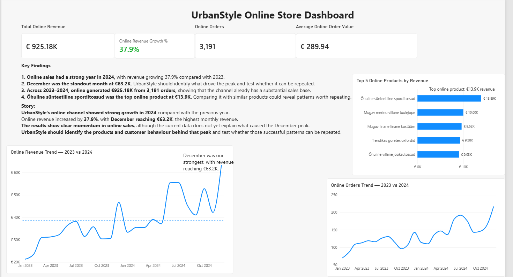
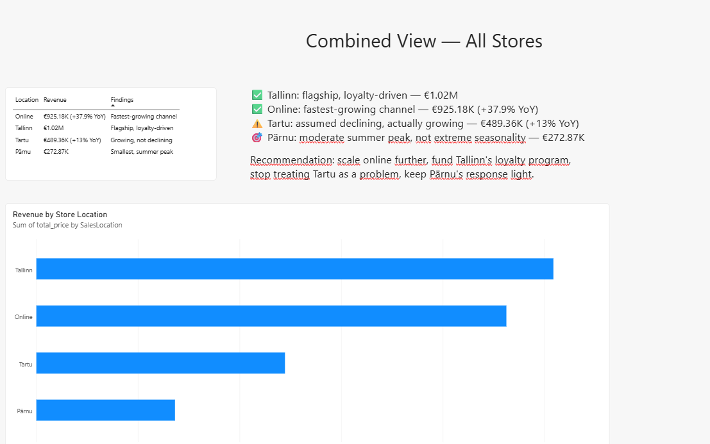

# Week 6 — Data Storytelling with Power BI

## My Role

**Role D — Online Store Story**

For Week 6, I focused on UrbanStyle's online sales channel. My task was not just to show the numbers, but to explain what was happening in online sales, what stood out, and what UrbanStyle could do next.

I worked with the 2023–2024 period because these were the complete years available for a fair comparison. Later data appeared incomplete and could have created a misleading decline.

## Dashboard

## Key Findings

- Online revenue grew **37.9% in 2024**, increasing from about **€388.97K in 2023 to €536.21K in 2024**.
- **December 2024 was the strongest month**, reaching **€63.2K** in online revenue.
- Across 2023–2024, online sales generated **€925.18K from 3,191 orders**, with an average order value of **€289.94**.
- **Õhuline sünteetiline sporditossud** was the strongest online product, generating about **€13.9K** in revenue.
- The growth is clear, but the available sales data does not tell us exactly what caused the December peak.

## Dashboard

## Data Story

UrbanStyle's online channel had a strong 2024, with revenue growing **37.9%** compared with the previous year. December was the strongest month, reaching **€63.2K**, while the overall online channel generated more than **€925K** across 2023–2024. The results show clear momentum in online sales, but the data alone does not explain what caused the strongest periods. Before increasing investment, UrbanStyle should identify which products, customers and campaigns were behind the growth and test whether those patterns can be repeated.

## Dashboard Design

I added KPI cards for revenue, revenue growth, orders and average order value. I also used an average reference line on the revenue trend so it was easier to see which months performed above or below the usual level.

I added annotations to highlight the December revenue peak and the best-performing online product. I also configured interactions so selecting a product changes the supporting trend charts without changing the headline KPI cards.

As an advanced feature, I used conditional formatting on the growth KPI so positive growth is highlighted visually.

## Recommendation

The online channel is a strong growth opportunity for UrbanStyle, but I would not recommend increasing investment based on revenue growth alone. The next step should be to investigate what drove the strongest months and products, then confirm whether those results can be repeated profitably.

## Team Combined View

Our team compared Tallinn, Tartu, Pärnu and Online to build a combined view of UrbanStyle's locations.

My contribution to the team work was the **Online Store dashboard, analysis and data story**.

One important team finding was that assumptions in the task description did not always match the real data. For example, Tartu was described as declining, but the team's analysis showed positive year-on-year growth. This reinforced the importance of checking the data rather than repeating assumptions.

## What I Learned

This week helped me understand that a dashboard is not finished just because the charts work.

I learned to ask **"So what?"** after finding a number. For example, knowing that online revenue grew 37.9% is useful, but the next question is what caused that growth and whether UrbanStyle can repeat it.

I also learned to be more careful about the difference between what the data **shows** and what I am only **assuming**. The December peak is visible in the data, but I cannot say that Christmas, Black Friday or a specific campaign caused it without supporting evidence.

Renee's feedback also made me pay more attention to layout, visual hierarchy, chart labels and making the main message easy to find without overcrowding the dashboard.

## AI Use

I used ChatGPT as a learning assistant during Week 6. It helped me understand Power BI features, check calculations, troubleshoot DAX and formatting problems, and question whether my interpretations were actually supported by the data.

I built and edited the dashboard myself in Power BI, checked the numbers and interactions as I worked, and made the final decisions about the findings, wording and recommendations.